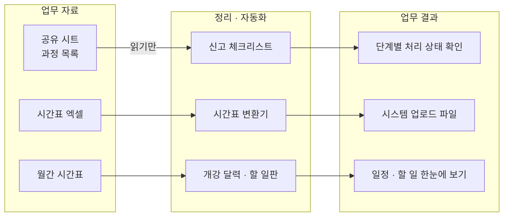
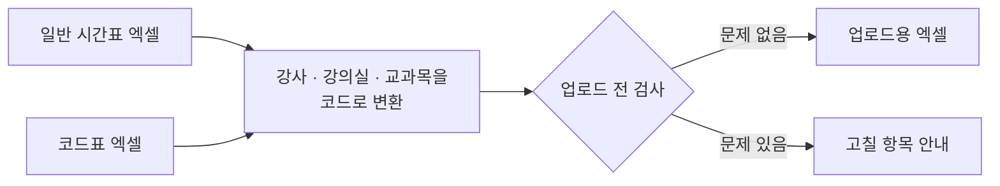

# Portfolio — 고객 응대 · 영업관리 · 운영

> 매장에서 고객을 만나고, 경리로 숫자를 맞추고, 교육기관에서 상담과 행정을 맡아 왔습니다.
> 반복되는 업무는 **규칙으로 정리해 도구로 바꿉니다.** 웹 개발 과정을 이수한 경험으로 **고객 · 운영 · 개발 사이의 말을 잇고자** 합니다.

## 왜 만들었나

고객을 안내하고 과정을 운영하는 업무에는 세 가지 어려움이 있었습니다.

1. **기한을 사람이 기억한다** — 과정 유형마다 신고 기한이 다르고, 놓치면 안 되는 단계가 있다.
2. **같은 내용을 다시 옮겨 적는다** — 시간표 엑셀 수백 줄을 시스템 업로드 양식에 맞게 손으로 바꿔야 한다.
3. **지금 어디까지 됐는지 한눈에 보이지 않는다** — 과정별 진행 상태를 하나씩 확인해야 한다.

이 세 가지를 **① 단계별 체크리스트, ② 엑셀 자동 변환, ③ 일정 · 할 일판**으로 풀었습니다.

## 걸어온 길

| 기간 | 분야 · 역할 | 맡은 일 |
|---|---|---|
| 2026.07 ~ 현재 | 직업훈련기관 · 영업관리 | 전화 · 온라인 문의 상담과 등록 안내, 블로그 · 인스타그램 홍보, 출결 · 수료 · 훈련과정 신고, 훈련비용 신청, 공문서 작성 |
| 2024.11 ~ 2026.06 | 웨딩업 · 관리부 (경리) | 고객 결제 승인 · 취소 확인, 업체 정산과 소통, 프로모션 정기보고, ERP · 고객관리시스템 관리, 급여 계산 |
| 2023.08 ~ 2024.02 | 교육 이수 | PHP 풀스택(프론트엔드 + 백엔드) 과정 |
| 2022.06 ~ 2023.07 | 반려동물 영양 협회 · 지부장 | 신문 칼럼 연재, 이론 수업과 센터 출강 |
| 2013.04 ~ 2022.09 | 패션 매장 · 사원 (시니어 역할) | 고객 관리와 상품 판매, 재고 · 디스플레이 관리 |

현재 한국방송통신대학교 컴퓨터과학과에 재학 중입니다 (2025.03 ~).

## 전체 구조

## 업무별 정리

| 업무 | 전 | 후 |
|---|---|---|
| 훈련과정 신고 관리 | 기한과 진행 상태를 기억으로 관리 | 시간표등록 → 변경인정 → 실시신고 → 확정자신고 → 수료보고를 **5단계로 체크** |
| 시스템용 시간표 작성 | 강사 · 강의실 · 교과목을 손으로 코드 변환 | 엑셀을 자동 변환하고 **업로드 전에 담당강사 등록 여부 검사** |
| 개강 일정 관리 | 월간 시간표를 하나씩 확인 | 달력과 **행정 7단계 할 일판**으로 정리 |

> **[▶ 업무 도구 시연](https://choibocknami12.github.io/-portfolio/demo/)** · **[▶ 개강 달력 시연](https://choibocknami12.github.io/-portfolio/demo/calendar.html)** — 가상 데이터로 핵심 동작을 다시 만든 페이지입니다.
>
> 실무 도구는 내부 자료와 개인정보 보호를 위해 코드와 화면을 공개하지 않습니다.
> 업무 규칙과 요구사항을 직접 정리하고, 구현에는 AI 코딩 도구를 활용했습니다.

## 실무에서 쓰려고 만든 도구

### 시간표 변환기 — 엑셀을 업로드용 파일로

일반 시간표와 코드표, **엑셀 두 개를 넣으면 시스템 업로드용 시간표가 만들어집니다.**

- 교시마다 한 줄로 나누고, 교시 사이 빈 시간은 **점심시간으로 채우며** 휴일은 제외합니다.
- 같은 강사도 과목 분류에 따라 코드가 다른 점을 반영합니다.
- 담당강사 미등록이나 없는 코드를 **업로드 전에 찾아** 시스템에서 거절되는 일을 줄입니다.
- 코드가 없으면 **추측해서 넣지 않고**, 이미 있는 파일은 덮어쓰지 않습니다.
- 설치 없이 여는 **웹 화면**으로도 만들었습니다.

`Python` · `openpyxl` · `JavaScript` · `HTML`

### 신고 체크리스트 — 구글 시트를 읽어 과정별로

공유 구글 시트를 읽어 **과정 목록을 자동으로 만들고** 신고 단계를 체크합니다.

- 원본을 지키기 위해 **읽기 전용 권한**만 쓰고, 시트에 붙이지 않은 독립 앱으로 만들었습니다.
- 개강 예정 · 진행 중 등으로 나누어 보고, 필수 신고를 놓치면 **빨갛게 표시**합니다.
- 체크하면 바로 저장되고, **PC와 휴대폰에서 이어서** 볼 수 있습니다.
- 강의실이 바뀌어도 체크 기록이 풀리지 않게 하고, 테스트 51건으로 확인했습니다.

`Google Apps Script` · `Google Sheets API` · `JavaScript`

### 개강 달력 · 할 일판 — 월간 시간표를 한눈에

구글 시트에서 내려받은 엑셀을 올리면 **개강 달력과 할 일 목록**이 갱신됩니다.

- 적용 전에 미리보기로 **확인이 필요한 항목**을 먼저 보여줍니다.
- 과정마다 남은 첫 단계를 골라 **기준일 지남 · 임박 · 여유** 순으로 정렬합니다.
- 시간표를 새로 올려도 **메모와 진행 체크는 유지**됩니다.

`HTML` · `JavaScript`

## 일하는 방식

### 1. 고객의 말을 듣고 맞는 길을 안내한다

매장 근무부터 지금의 상담 업무까지 고객을 직접 만나 왔습니다. 전화와 온라인 문의를 받아 **상담하고 훈련과정 등록을 안내**합니다.

### 2. 확신이 들 때까지 두 번 확인한다

경리 업무에서는 반드시 이중으로 확인했습니다. 모호한 부분은 대표에게 확인받거나 **세무사 · 공공기관에 직접 문의해 근거를 확보**했습니다. 숫자 오류는 원인을 끝까지 역추적했습니다.

### 3. 빠르게 익히고 양식을 고쳐 쓴다

하루의 인수인계 뒤 사수 없이 **한 달 만에 업무에 적응**했고, 단기간에 주임으로 진급했습니다. 비효율적인 양식은 고쳐서 실무에 적용했습니다.

### 4. 함께 쓰는 자료는 건드리지 않는다

신고 체크리스트는 여러 사람이 쓰는 공유 시트를 **읽기만** 하고, 체크 상태는 따로 저장합니다. 화면도 본인만 열 수 있습니다.

### 5. 제출하기 전에 검사한다

시간표 변환기는 업로드 전에 담당강사 등록 여부를 확인합니다. 첫 실제 사용에서 **760교시 업로드에 성공**했습니다. 기준이 확정되지 않은 기한은 추측하지 않고 담당자가 직접 적습니다.

## IT 서비스 이해 — Class4You

온라인 클래스 플랫폼을 **2인 팀**으로 만든 프로젝트입니다 (2023.12.04 ~ 2024.01.22). **서비스가 운영되는 구조를 이해하는 바탕**이 되었습니다.

| 운영 관점 | 서비스에 담긴 기능 | 위치 |
|---|---|---|
| 회원 | 이메일 인증 · 카카오 로그인 · 임시 비밀번호 · 회원 정지 | [컨트롤러](Class4You/app/Http/Controllers/) |
| 고객 문의 | 강의 질문 · 커뮤니티 · 신고 처리 | [화면](Class4You/resources/components/) |
| 현황 파악 | 결제 · 가입 · 연령대 · 인기 강의 통계 | [관리자 메인](Class4You/resources/components/AdminMainComponent.vue) |
| 데이터 | 회원 · 강의 · 수강 · 신고의 연결 구조 | [DB 설계](Class4You/database/) |

## 활용 도구

| 구분 | 내용 |
|---|---|
| 사무 · 관리 | Microsoft Excel · ERP · 고객관리시스템 · 전표처리 · 재고관리 |
| 협업 | Notion · Slack · Jira · GitHub |
| 업무 자동화 | Google Apps Script · 구글 시트 연동 · AI 코딩 도구 |
| 웹 기초 | HTML · CSS · JavaScript · PHP · Laravel · Vue · MariaDB |
| 데이터 기초 | [Python 공공 API · pandas 실습](https://github.com/choibocknami12/workspace_project/tree/main/Python) |
| 문서 | 공문서 · 정기보고 · 칼럼 · [설치 안내](docs/INSTALL.md) |

## 배운 것

- **자동화보다 업무 규칙 정리가 먼저다.** 단계와 기준이 분명해야 도구도 정확해진다.
- **실수는 조심보다 구조로 줄인다.** 이중 확인과 사전 검사가 기억보다 믿을 만하다.
- **소통은 전달에서 끝나지 않는다.** 고객과 협력사의 요청을 확인하고 정리해 결과까지 알려야 한다.
- **운영 화면을 알면 고객 문의가 다르게 보인다.** 문의가 어느 기능과 데이터에서 시작됐는지 짚어 전달할 수 있다.
